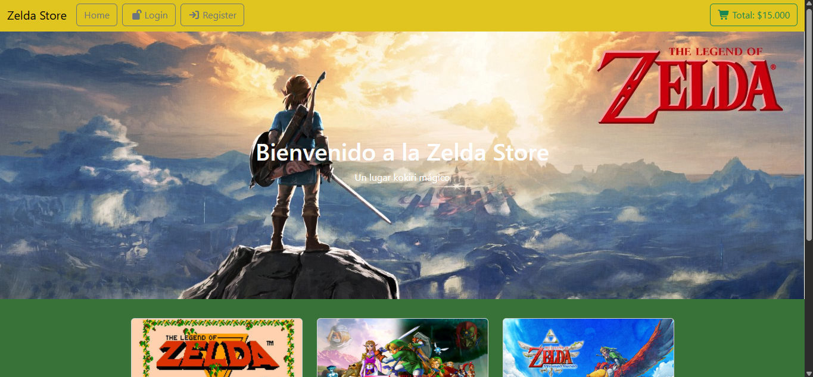

# Zelda Store

Tienda tematica del conocido clasico The Legend of Zelda.

## Screenshot



## Descripcion

Zelda Store es una aplicacion de e-commerce ficticia de tipo SPA (Single Page Application), donde se muestran distintos productos de la saga Zelda mediante cards con imagen, nombre, caracteristicas y precio. Incluye navegacion entre paginas con React Router, catalogo de productos, carrito de compras con estado global mediante Context API y pie de pagina.

## Tecnologias utilizadas

- React
- Vite
- React Router 6
- Context API
- Bootstrap 5
- CSS3
- JavaScript (ES6+)

## Rutas

| Ruta | Pagina |
|---|---|
| `/` | Home (catalogo de productos) |
| `/register` | Registro |
| `/login` | Inicio de sesion |
| `/cart` | Carrito de compras |
| `/pizza/p001` | Detalle de un producto |
| `/profile` | Perfil de usuario |
| `/404` y cualquier otra | Pagina NotFound |

## Estructura del proyecto

```
src/
├── components/   # Navbar, Footer, CardZelda, datos del carrito
├── context/      # CartContext (estado global del carrito)
├── pages/        # Home, Register, Login, Cart, Pizza, Profile, NotFound
├── App.jsx       # Definicion de rutas
└── main.jsx      # BrowserRouter y punto de entrada
```

## Funcionalidades

- Navegacion sin recargar la pagina usando `Link` de React Router
- Navbar responsive con enlaces a Home, Login, Register, Profile y boton de Total que lleva al carrito
- Catalogo de productos cargado desde una API local mediante `fetch`, con componente reutilizable `CardZelda`
- Boton "Añadir" en cada card para agregar productos al carrito desde Home
- Carrito de compras con estado global: aumentar y disminuir cantidades, y eliminar el producto al llegar a 0
- Total de la compra calculado y sincronizado entre el Navbar y la pagina Cart
- Pagina NotFound con enlace de regreso al inicio
- Pagina de perfil con email y boton de cerrar sesion (estaticos por ahora)
- Footer con informacion de derechos reservados
- Formateo de precios con separador de miles (en clp)