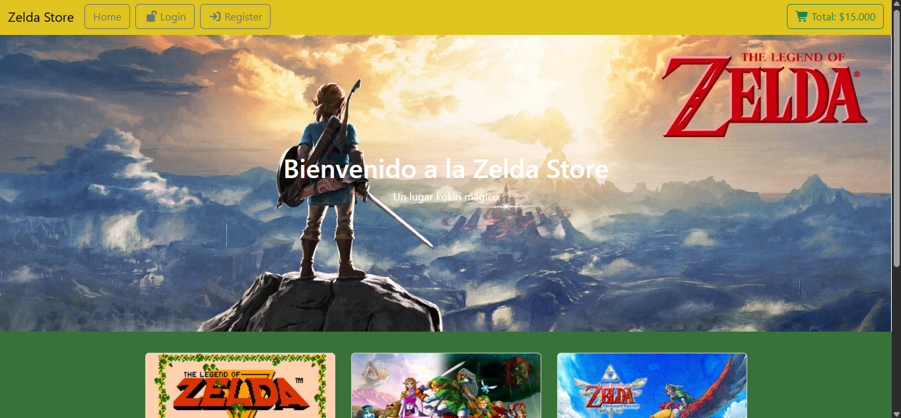

# Zelda Store

Tienda tematica del conocido clasico The Legend of Zelda.

## Screenshot



## Descripcion

Zelda Store es una aplicacion de e-commerce ficticia de tipo SPA (Single Page Application), donde se muestran distintos productos de la saga Zelda mediante cards con imagen, nombre, caracteristicas y precio. Incluye navegacion entre paginas con React Router, catalogo de productos, carrito de compras con estado global mediante Context API y pie de pagina.

## Tecnologias utilizadas

- React
- Vite
- React Router 6
- Context API
- JWT (autenticacion con backend en Express)
- Bootstrap 5
- CSS3
- JavaScript (ES6+)

## Rutas

| Ruta                    | Pagina                                                                  |
| ----------------------- | ----------------------------------------------------------------------- |
| `/`                     | Home (catalogo de productos)                                            |
| `/register`             | Registro (redirige si ya hay sesion activa)                             |
| `/login`                | Inicio de sesion (redirige si ya hay sesion activa)                     |
| `/cart`                 | Carrito de compras                                                      |
| `/pizza/p001`           | Detalle de un producto (id obtenido con `useParams`)                    |
| `/profile`              | Perfil de usuario (ruta protegida, redirige a `/login` si no hay token) |
| `/404` y cualquier otra | Pagina NotFound                                                         |

## Estructura del proyecto

```
src/
├── components/   # Navbar, Footer, CardZelda, datos del carrito
├── context/      # CartContext (estado global del carrito), UserContext (token, email, login, register, logout y perfil)
├── pages/        # Home, Register, Login, Cart, Pizza, Profile, NotFound
├── App.jsx       # Definicion de rutas y rutas protegidas
└── main.jsx      # BrowserRouter, UserProvider y punto de entrada
```

## Funcionalidades

- Autenticacion real con JWT en `UserContext`: metodos `login` y `register` que consumen `/api/auth/login` y `/api/auth/register`, y almacenan el token y el email en el estado y en `localStorage`
- Boton "Añadir" en cada card para agregar productos al carrito desde Home
- Boton "Pagar" del carrito deshabilitado cuando no hay sesion activa o el carrito esta vacio
- Boton "Ver mas" en cada card que lleva al detalle del producto con su id en la URL
- Carrito de compras con estado global: aumentar y disminuir cantidades, y eliminar el producto al llegar a 0
- Catalogo de productos cargado desde una API local mediante `fetch`, con componente reutilizable `CardZelda`
- Envio del carrito al backend (`/api/checkouts`) con el token JWT en el header, con mensaje de exito al completar la compra y vaciado del carrito
- Footer con informacion de derechos reservados
- Formateo de precios con separador de miles (en clp)
- Formularios de Login y Register conectados a `UserContext`, con validaciones en el cliente y mensajes de error del backend
- Metodo `getProfile` que consulta `/api/auth/me` con el token para obtener el perfil del usuario autenticado
- Metodo `logout` que elimina el token y el email del estado y del `localStorage`
- Navegacion sin recargar la pagina usando `Link` de React Router
- Navbar responsive con enlaces a Home y boton de Total que lleva al carrito; muestra Profile y Logout cuando hay sesion, y Login y Register cuando no la hay
- Pagina de detalle que obtiene el id con `useParams` y consulta la API para mostrar la informacion del producto
- Pagina NotFound con enlace de regreso al inicio
- Pagina de perfil con el email del usuario autenticado y boton de cerrar sesion
- Ruta protegida `/profile` y redireccion desde `/login` y `/register` cuando hay sesion activa
- Total de la compra calculado y sincronizado entre el Navbar y la pagina Cart
